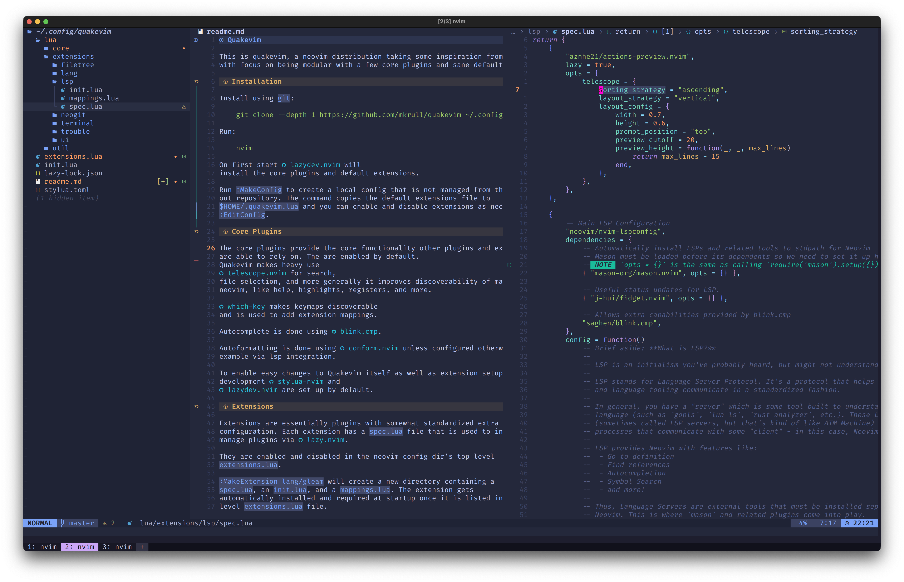
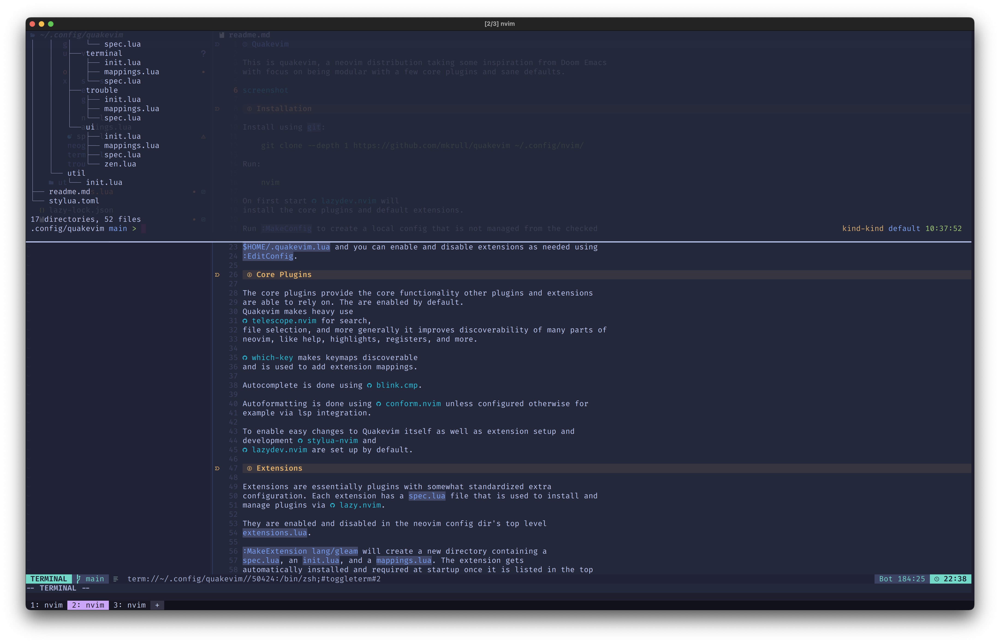
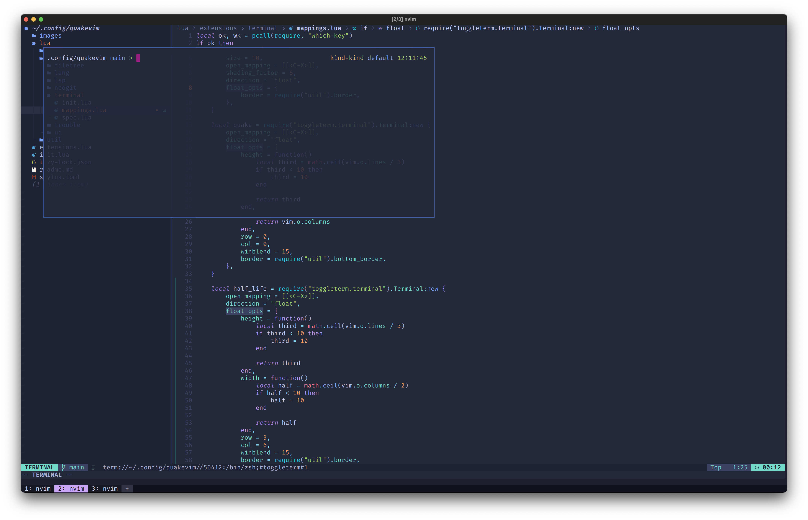
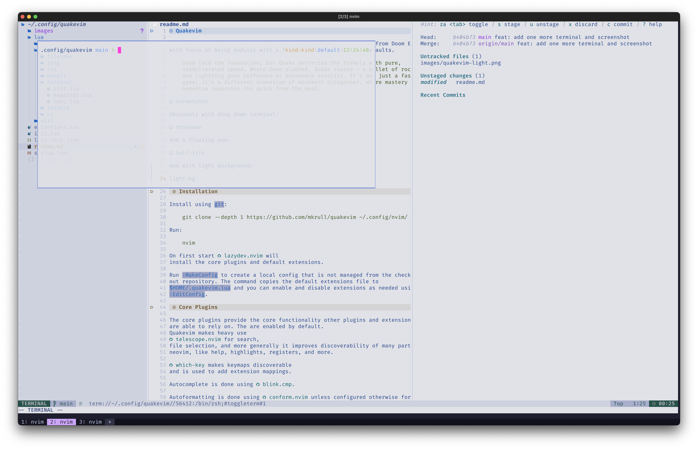

# Quakevim

This is quakevim, a neovim distribution taking inspiration from Doom Emacs
with a focus on being modular with a few core plugins and sane defaults.

    Doom laid the foundation, but Quake perfected the formula with pure,
    unadulterated speed. Where Doom plodded, Quake soared — a ballet of rockets
    and lightning guns performed at breakneck velocity. It’s not just a faster
    game; it’s a different dimension of movement altogether, where mastery of
    momentum separates the quick from the dead.



Obviously with drop down terminal:



And a floating one:



And with light background:



## Installation

Install using `git`:

    git clone --depth 1 https://github.com/mkrull/quakevim ~/.config/nvim/

Run:

    nvim

On first start [lazy.nvim](https://github.com/folke/lazy.nvim) will
install the core plugins and default extensions.

## Configuration

Quakevim has a high level configuration file that can be accessed using
`:EditConfig`.

Run `:MakeConfig` to create a local config that is not managed in the checked
out repository. The command copies the default extensions file to
`$HOME/.quakevim.lua` and you can enable and disable extensions as needed using
`:EditConfig`. The local config is authoritative: if it exists it fully
replaces the default `extensions.lua`.

The default configuration looks something like this:

```lua
return {
    config = {
        colorscheme = "tokyonight-storm",
    },
    extensions = {
        "filetree", -- files in the sidebar
        "lsp", -- interact with your code like a pro
        "neogit", -- magit for the other editor
        "terminal", -- better than !
        "trouble", -- diagnostics overview
        "ui", -- ui goodness, some might say clutter

        -- language extensions
        -- "lang/gleam",
        -- "lang/go", -- limbo, but compiled
        "lang/markdown",
        -- "lang/yaml",
    },
}
```

## Core Plugins

The core plugins provide the core functionality other plugins and extensions
are able to rely on. They are enabled by default.
Quakevim makes heavy use of the
[snacks.nvim](https://github.com/folke/snacks.nvim) picker for search,
file selection, and more generally it improves discoverability of many parts of
neovim, like help, highlights, registers, and more.

[which-key](https://github.com/folke/which-key.nvim) makes keymaps discoverable
and is used to add extension mappings.

Autocomplete is done using [blink.cmp](https://github.com/saghen/blink.cmp).

Autoformatting is done using [conform.nvim](https://github.com/stevearc/conform.nvim) unless configured otherwise, for
example via lsp integration.

Lua files are formatted with [stylua](https://github.com/JohnnyMorganz/StyLua)
through [conform.nvim](https://github.com/stevearc/conform.nvim), picking up the
`stylua.toml` in this repository. To enable easy changes to Quakevim itself as
well as extension setup and development
[lazydev.nvim](https://github.com/folke/lazydev.nvim) is set up by default.

Run `:checkhealth quakevim` to validate your configuration: it checks that the
config files parse, that all enabled extensions exist and that language
tooling (mason binaries, treesitter parsers) for the enabled language
extensions is installed.

## Extensions

Extensions are essentially plugins with somewhat standardized extra
configuration. Each extension has an `init.lua` with setup code and mappings
and can have a `spec.lua` that is used to install and manage plugins via
[lazy.nvim](https://github.com/folke/lazy.nvim).

They are enabled and disabled in the neovim config dir's top level
`extensions.lua`.

`:MakeExtension lang/gleam` will create a new directory containing an
`init.lua` for setup and mappings and a `spec.lua` for plugins managed via
[lazy.nvim](https://github.com/folke/lazy.nvim). The extension gets
automatically installed and required at startup once it is listed in the top
level `extensions.lua` file.
